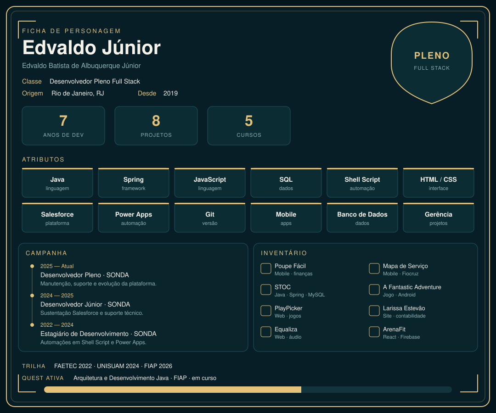

Sou desenvolvedor pleno full stack no Rio de Janeiro, desenvolvendo desde 2019, no freelance e na SONDA. Técnico em Desenvolvimento de Software pela FAETEC, formado em Análise e Desenvolvimento de Sistemas pela UNISUAM e, desde 2026, na pós em Arquitetura e Desenvolvimento Java pela FIAP. A ficha acima é o retrato. Os links estão no [portfólio](https://edvaldodev-e05b2.web.app/).

## Campanha

**2025 — atual · Desenvolvedor de Software Pleno · SONDA**
Sustentação Salesforce: manutenção, funcionalidades novas, suporte técnico e evolução da plataforma.

**2024 — 2025 · Desenvolvedor de Software Júnior · SONDA**
A mesma frente, em sustentação: manutenção, funcionalidades e suporte.

**2022 — 2024 · Estagiário de Desenvolvimento · SONDA**
Automações com Shell Script para processos de dados e sistemas simples em Power Apps.

## Inventário

| Projeto | O que faz |
| --- | --- |
| [Poupe Fácil](https://play.google.com/store/apps/details?id=com.poupefacil.app) | App móvel híbrido para registrar gastos, acompanhar saldo e achar onde economizar. |
| Mapa de Serviço | Informações dos serviços da Fiocruz, com localização e feedback. |
| [STOC](https://github.com/Azulrok/Stoc_V2) | Estoque em Java, Spring e MySQL: produtos, movimentação e fornecedores. |
| [A Fantastic Adventure](https://play.google.com/store/apps/details?id=com.twoblocks.studios) | Jogo de aventura para Android: correr, pular, desviar e desbloquear um poder. |
| [PlayPicker](https://play-picker.netlify.app) | Site para escolher o próximo jogo. |
| [Larissa Estevão Contabilidade](https://larissa-estevao-contadora.netlify.app/) | Site da contadora, com serviços, contato e WhatsApp. |
| [Equaliza](https://equaliza-29eca.web.app/) | Guia de equalização para técnicos de PA, igreja, estúdio e passagem de som. |
| ArenaFit | App web de treinos, pontos e comunidade, em React e Firebase. |

## Trilha

| Ano | Formação |
| --- | --- |
| 2026 — cursando | Pós-graduação em Arquitetura e Desenvolvimento Java · FIAP |
| 2024 | Análise e Desenvolvimento de Sistemas · UNISUAM |
| 2022 | Desenvolvimento de Software · FAETEC ETE Juscelino Kubitschek |
| 2020 | Técnicas Administrativas · Instituto Brasileiro de Aprendizagem |

Cursos

 

| Curso | Quando |
| --- | --- |
| Infraestrutura e Arquiteturas para Suporte às Aplicações | 2024 · 340h |
| Desenvolvimento de Aplicativos Mobile | 2024 · 340h |
| Desenvolvimento de Software para Internet (Back-End) | 2023 · 340h |
| Desenvolvimento de Software para Internet (Front-End) | 2023 · 340h |
| Qualificação em Gerência de Projetos de Software | 2022 · 340h |

## Atributos

**Java · Spring · JavaScript · HTML · CSS · Shell Script · SQL**

**Salesforce · Power Apps · Git · Mobile · Banco de Dados · Gerência de Projetos**

## Contato

edvaldojunior.desenvolvedor@gmail.com

Rio de Janeiro · ficha de personagem · 2026
